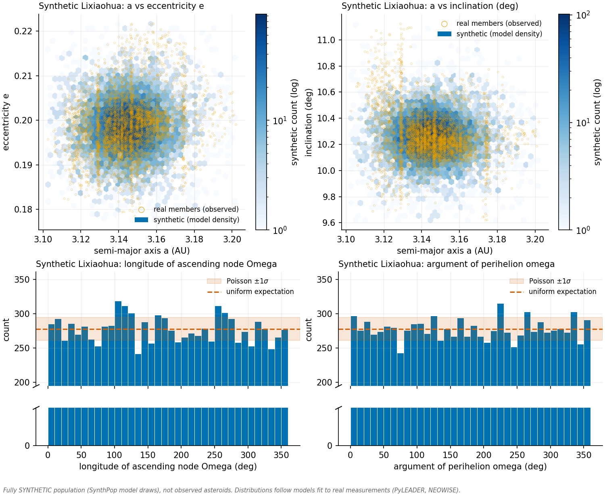
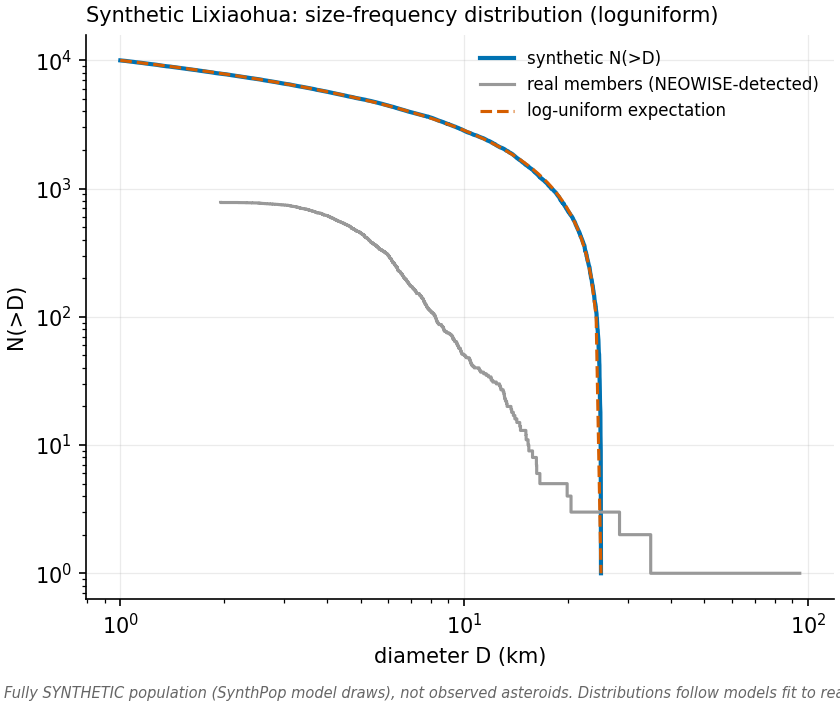
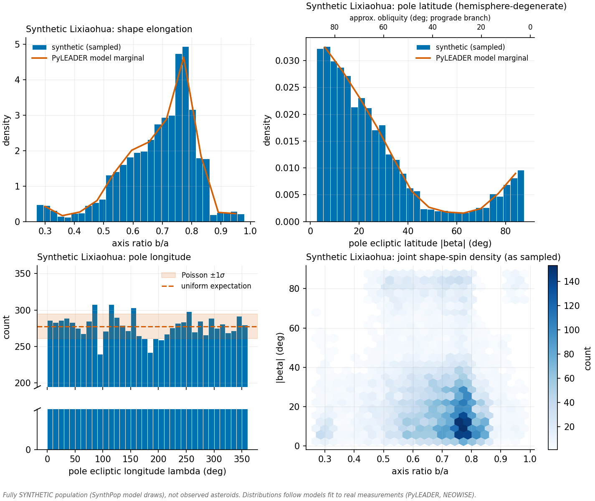
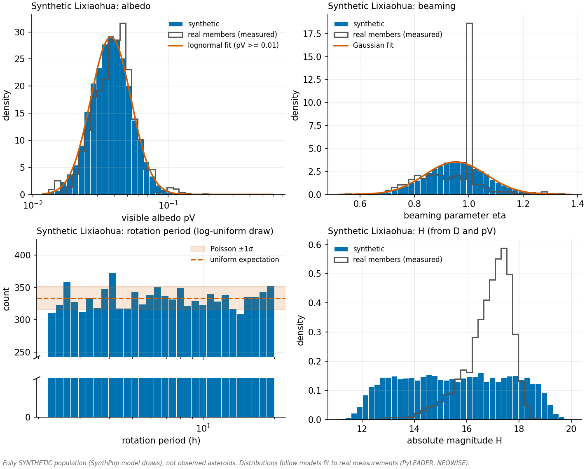

# SynthPop


SynthPop generates catalogs of **synthetic Main-Belt asteroids** whose physical
and orbital properties follow the distributions measured or expected from prior
studies. It is the first of two pipelines downstream of
[PyLEADER](https://github.com/SarahSonnett/PyLEADER): SynthPop consumes the
population-level shape and spin distributions that PyLEADER recovers, and its
output catalog is in turn the input to a survey simulator (Simmer, developed
separately) that reproduces the NEOWISE observing cadence, geometry, and
sensitivity in order to determine which synthetic objects the mission would
have detected.

Each synthetic population models one *dynamically distinct* subpopulation of
the Main Belt: either an established **collisional family** or a portion of the
**background** (non-family) population.

> **Scope of this repository.** This is the public engineering snapshot of an
> active research pipeline: the full generator, its tests, CI, a self-contained
> demo, and the methods documentation. The **science products** built with it —
> the belt-wide sample of family and background populations, their fitted
> parameters and Monte-Carlo ensembles, and the production batch configurations
> — are **withheld pending peer-reviewed publication** (paper in preparation),
> as are the PyLEADER shape/spin distributions they consume. Code: BSD-3
> licensed — please cite via `CITATION.cff`.

## Assigned properties

| property | symbol | source |
|----------|--------|--------|
| diameter | `D` | (broken) power-law SFD, or log-uniform for detection-efficiency applications |
| shape elongation | `b/a` | PyLEADER joint distribution `f_mean(p, β)` for the object's diameter bin |
| pole latitude | `β` | same joint draw; stored as the magnitude \|β\| (hemisphere-degenerate; see the β convention below) |
| pole longitude | `λ` | uniform on [0°, 360°) (unconstrained by LEADER) |
| rotation period | `P` | log-uniform, 2.2–20 h by default (configurable) |
| orbit | `a, e, i, Ω, ω, M` | s3m model (background) **or** family-based generation |
| geometric visible albedo | `p_V` | fit to NEOWISE measurements: lognormal (family; double lognormal when the members test bimodal) / double Rayleigh (background) |
| beaming parameter | `η` | Gaussian fit to NEOWISE measurements, MCMC-sampled |
| absolute magnitude | `H` | derived from `D` and `p_V` |

Within a subpopulation, `p_V`, `η`, and the remaining properties are sampled
independently — no intrinsic correlations are assumed — following the approach
of Lilly et al. (2021) for the NEO Surveyor synthetic population model.

**Convention for β.** `β` is the **ecliptic latitude of the spin pole**, the
standard convention of lightcurve inversion (e.g., Hanuš et al. 2011, 2013),
not the obliquity: β = 0° is an axis in the
ecliptic plane and |β| = 90° an axis perpendicular to it. LEADER cannot
distinguish the hemispheres, so only |β| ∈ [0°, 90°] is constrained, and the
catalog column `pole_beta_deg` records that magnitude (no hemisphere is
assigned). Nortunen & Kaasalainen (2017, Sect. 2) write β for a different
angle, the colatitude (the angle of the spin axis from the ecliptic pole,
90° − |β|). For a low-inclination orbit the obliquity is approximately
90° − |β| (prograde branch) or 90° + |β| (retrograde branch).

*Known issue (2026-10-12).* PyLEADER summaries produced to date store the
colatitude, and SynthPop copies it into `pole_beta_deg` unconverted, so
catalogs produced to date hold the colatitude rather than |β| (for a
low-inclination orbit, obliquity ≈ the stored value on the prograde branch or
180° minus it on the retrograde branch). The fix is scheduled upstream:
PyLEADER will write |β| with an explicit convention key, which SynthPop will
check and record in each catalog's provenance. Until then, read
`pole_beta_deg` in existing catalogs as the colatitude. The `shape_pole.png`
figure has the same problem: its latitude labels are wrong for these catalogs,
and its secondary "approx. obliquity" axis (90° minus the plotted value) shows
|β| rather than the obliquity.

**Diameter sampling laws.** `--sfd powerlaw` (the default) draws from a
realistic cumulative distribution `N(>D) ∝ D^−slope`. `--sfd loguniform` draws
equal numbers of objects per logarithmic diameter interval — an intentionally
non-physical SFD that provides comparable statistics at every size, including
the intrinsically rare large objects. The latter is appropriate when the
synthetic population serves to estimate the per-size detection probability
`P(detect | D)` for survey debiasing (the Simmer application), in which case
the shape of the synthetic SFD is immaterial and minimizing per-bin counting
noise is the governing consideration.

## Method

The pipeline executes five stages (`synthpop/pipeline.py`):

1. **Size** (`sfd.py`) — inverse-transform sampling from the selected diameter
   law; the power-law form supports an optional break diameter with distinct
   slopes above and below.

2. **Shape and pole** (`shape_pole.py`) — for each object, the PyLEADER
   diameter bin containing its `D` is identified (the narrowest containing bin
   is preferred; objects outside all bins adopt the nearest bin), and `b/a`
   and β are drawn *jointly* from that bin's `f_mean(p, β)`, preserving any
   correlation between shape and spin-axis orientation. `λ` is drawn uniformly.

3. **Orbits** —
   * **Background** (`orbits_bg.py`): orbital elements are bootstrap-resampled
     from the corresponding region of the s3m synthetic solar-system model
     (Grav et al. 2011) — inner/middle/pristine/outer Main Belt, Hungarias,
     and Cybeles. The expected file schema is documented in
     [`data/s3m_schema.md`](data/s3m_schema.md).
   * **Family** (`orbits_family.py`): two generators are provided, selected
     with `--family-orbit-model`.
     - `dorb` (default) follows Schunová-Lilly et al. (2017): a Gaussian is
       fit to each observed proper element (`a`, `e`, `sin i`); each member's
       standardized orbital distance from the family center, `D_orb`, is
       computed; a power law `D_orb = A·D^γ` is fit against member diameter
       (smaller members lie systematically farther from the center, as
       expected from Yarkovsky dispersion); synthetic elements are placed at
       the `D_orb` predicted for their assigned diameter, with Gaussian
       scatter, in a random direction in standardized element space; and any
       element falling outside the observed family's bounds is rejected and
       redrawn. Being an isotropic Gaussian model, `dorb` cannot represent
       multimodal or resonance-sculpted families.
     - `resample` performs a size-matched bootstrap of the real members: for
       each synthetic object, a member of similar diameter is selected (from
       the `resample_k_neighbors` nearest in log D), its `(a, e, sin i)`
       adopted, and a Gaussian kernel jitter added (Scott's-rule bandwidth
       per element), with the same bounds clipping. This reproduces the
       observed multimodality, resonance edges, and element correlations
       together with the empirical size–orbit coupling, at the cost of
       inheriting the member sample's Poisson noise and selection effects.
       Running the downstream simulator with both generators bounds the
       orbit-model systematic on the debiased size-frequency distribution.

4. **Physical parameters** (`physical.py`) — `p_V` and `η` are fit over the
   relevant NEOWISE sample and synthetic values are drawn from the fitted
   densities (by Markov-chain Monte Carlo, or exactly for mixture models).
   The albedo model follows the population type: a collisional family is
   modeled with a single **lognormal** (a Gaussian in log-albedo, σ-clipped
   to reject interlopers in the membership list); a background population
   mixes C- and S-complex taxonomies and is modeled with the
   **double-Rayleigh** distribution of Wright et al. (2016).

   **Bimodality test.** Not every family is taxonomically homogeneous: some
   (e.g. Phocaea, Tirela, Juno, Flora, Eos) carry two albedo components. In
   family mode the member albedos are therefore tested against a
   two-component Gaussian mixture in log-albedo
   (`distributions.assess_albedo_bimodality`), and the model is upgraded to
   a **double lognormal** when either (i) the fitted mixture shows two
   resolved peaks with a genuine dip between them (ΔBIC > 10, Ashman's
   D > 2, minor weight ≥ 0.10, dip ratio < 0.7 — Phocaea, Tirela, Juno), or
   (ii) the two-component evidence is overwhelming even though the
   components blend without a dip (ΔBIC > 50 with minor weight ≥ 0.15 —
   Flora, Vesta, Baptistina, Eunomia, Eos). The decision statistics are
   recorded in the provenance file.

   **Interloper exclusion (the dark tail).** All family fits σ-clip the
   member albedos (3σ, iteratively, in log-albedo) before fitting. This is
   a deliberate membership cut, not merely numerical hygiene: HCM-derived
   family lists are contaminated by interlopers from neighboring families
   and the local background, and in bright families (Vesta, Eunomia, Eos,
   Baptistina) those contaminants appear as a short dark tail 3–4σ below
   the log-mean — e.g. the clip removes 166 of Eos's 179 clipped members
   from the dark side, essentially the entire p_V < 0.08 tail in Vesta and
   Eunomia. The default therefore models the *family*, on the interpretation
   that its dark tail is predominantly contamination rather than genetic
   members. Users who instead want that tail represented — e.g. for
   consistency with detected counts drawn from the same uncleaned
   membership list — can request `--albedo-model mixture`: a BIC-selected
   k-component (k ≤ 3) lognormal mixture fit on the **unclipped** sample,
   in which a genuine few-percent dark group receives its own component
   (verified to reproduce the measured dark fractions of all four families
   above). If the mixture option is used for debiasing, the detected-count
   side of the ratio should retain its contaminants as well, so that the
   two sides of the ratio describe the same population.

   A σ-clipped linear Gaussian is also provided; any model may be imposed
   in any mode via `--albedo-model`. Sampled
   albedos are truncated below `--albedo-min` (default 0.01), as albedos below
   ≈1% have not been measured for any asteroid.

   **Beaming parameter and assumed values.** `η` is always modeled as a
   truncated Gaussian, fit by default over **all** NEOWISE rows of the
   sample. That default carries a known bias: the PDS table assigns
   quantized *assumed* beaming values (0.7, 0.95, 1.0, 1.2, 1.4 — 76% at
   exactly 1.0) to rows whose fit code lacks `B` (beaming not actually fit),
   and such rows constitute 40–80% of a typical family's sample, pulling the
   fitted mean toward η = 1 and shrinking the width (e.g. Eulalia
   1.036 ± 0.152 with all rows versus 1.142 ± 0.228 fitted-only; Hungaria
   1.040 ± 0.168 versus 1.212 ± 0.302). The `--eta-fitted-only` sensitivity
   option restricts the fit to fit-code-`B` rows; note the fitted subset is
   the brighter, better-observed sample and so carries its own selection
   bias — the option bounds the systematic rather than removing it.
   Provenance records `fitted_only` and `n_eta_fit` for every run.

   *Small-sample behavior of `--eta-fitted-only`:* (i) with ≥ 10 fitted
   rows the fit proceeds, and the bootstrap ensemble propagates the sample
   size honestly — each member refits a resample, so a thin sample widens
   the member-to-member spread automatically (Hungaria, 73 fitted rows:
   the ensemble's η means scatter ±0.032, versus ±0.009 for its 334-row
   all-rows fit); (ii) below 10 fitted rows the fit raises an error rather
   than propagating a meaningless Gaussian into the catalog; (iii) for
   marginal samples (only slightly above 10), individual bootstrap
   resamples can fall under the threshold and the ensemble fails loudly
   mid-run — the intended refusal, since a family that thin is better
   served by the all-rows default or a regional prior than by a
   family-specific fitted-only Gaussian.

5. **Assembly and output** (`assemble.py`, `io.py`) — the stages are joined
   into a single catalog, one row per object, written with the run
   configuration and a provenance record of every fitted parameter.

## Installation

```sh
pip install -r requirements.txt
```

The pipeline requires only `numpy`, `scipy`, `pandas`, and `matplotlib` (the
same footprint as PyLEADER). `pyarrow` is optional and needed only for
`--format parquet`.

## Quickstart (no external data)

```sh
python scripts/demo_quickstart.py        # ~30 seconds
```

The demo fabricates a complete input set for a *fictitious* collisional
family — a PyLEADER-style joint shape/spin distribution in two diameter
bins, a proper-elements member file with Yarkovsky-like size-dependent
dispersion, and a NEOWISE-style measurement table — then runs the full
pipeline against it and writes the catalog, the provenance record, and the
four diagnostic figures under `synthpop_out/Demonstranda/`. Nothing outside
this repository is read.

## Usage

### Command line

```sh
# A collisional family (Hygiea, family 10); no s3m file is required.
# The PyLEADER bins available here span 3-25 km, so --dmin/--dmax are matched to them.
python scripts/run_synthpop.py \
    --name Hygiea --mode family \
    --leader-base ~/pyleader_runs --leader-tag Fam10 \
    --neowise ~/Desktop/work/MBA_SFDs/neowise_mainbelt.csv \
    --family ~/Desktop/work/MBA_SFDs/AFP_families/a10v50.txt \
    --n 10000 --dmin 3 --dmax 25

# A background region (inner-belt C types); requires an s3m file.
python scripts/run_synthpop.py \
    --name BG_IB_Ctypes --mode background \
    --leader-base ~/pyleader_runs --leader-tag Fam<id> \
    --neowise ~/Desktop/work/MBA_SFDs/neowise_mainbelt.csv \
    --s3m ~/data/s3m_innerbelt.txt \
    --n 10000
```

`--leader-tag` identifies the PyLEADER population by family id (`Fam10`, `10`,
…); the corresponding `Fam<id>_..._<low>km_to_<high>km_summary` directories are
discovered recursively under `--leader-base`, independent of the enclosing
run-label directory names.

- **What it does:** generates one synthetic subpopulation — sizes, shapes,
  poles, rotation periods, orbits, and physical parameters — and writes the
  standalone catalog, its provenance, and the diagnostic figures.
- **Arguments:**
  - `--name NAME` label for the population; prefixes every output file and the object identifiers *(required unless `--config`)*
  - `--leader-base PATH` directory searched (recursively) for PyLEADER `*_summary` outputs *(required unless `--config`)*
  - `--leader-tag TAG` PyLEADER family id — `Fam3556`, `3556`, … *(required unless `--config`)*
  - `--mode {family,background}` population type; selects the orbit generator and the default albedo model *(default* `background`*)*
  - `--family PATH` family proper-elements file `a<famid>v<vcut>.txt` from the [Asteroid Families Portal](http://asteroids.matf.bg.ac.rs/fam/), or any file with the same six columns; see [Inputs and data availability](#inputs-and-data-availability) *(required in family mode)*
  - `--family-orbit-model {dorb,resample}` family orbit generator — the Schunová-Lilly Gaussian/D_orb model, or the structure-preserving size-matched bootstrap; see [Method](#method) *(default* `dorb`*)*
  - `--s3m PATH` s3m model file for the region *(required in background mode; see* [`data/s3m_schema.md`](data/s3m_schema.md)*)*
  - `--neowise PATH` NEOWISE diameters/albedos table (PDS; Mainzer et al. 2019), for the `p_V`/`η` fits *(required)*
  - `--n N` number of synthetic asteroids *(int ≥ 1, default 10000)*
  - `--dmin KM` / `--dmax KM` diameter range in km *(default 1–100; should be matched to the available PyLEADER bins)*
  - `--sfd {powerlaw,loguniform}` diameter sampling law — a realistic power law, or equal counts per logarithmic bin for detection-efficiency applications *(default* `powerlaw`*)*
  - `--slope S` cumulative power-law slope, `powerlaw` mode only *(default 2.5)*
  - `--albedo-model {gaussian,lognormal,double-lognormal,double-rayleigh,mixture}` albedo fit model *(default: selected by mode —* `lognormal` *for families, upgraded to* `double-lognormal` *when the member albedos test bimodal;* `double-rayleigh` *for backgrounds;* `mixture` *fits a BIC-selected k-component lognormal mixture on the unclipped sample, representing the interloper dark tail the default excludes — see [Method](#method))*
  - `--eta-fitted-only` fit the beaming parameter only to rows whose η was actually fit by NEOWISE (PDS fit-code contains `B`), excluding the quantized assumed values (0.7/0.95/1.0/1.2/1.4) that otherwise pull the fit toward η = 1 and shrink its width; a sensitivity option; see the Method section for the measured fit impacts and the small-sample behavior *(optional; default uses all rows)*
  - `--albedo-min PV` lower truncation of the sampled albedo distribution *(default 0.01; albedos below ≈1% have not been measured)*
  - `--restrict-neowise` fit `p_V`/`η` to the family's own numbered members rather than to all NEOWISE Main-Belt asteroids *(optional; recommended in family mode)*
  - `--seed N` random seed, for reproducibility *(int, default 0)*
  - `--out PATH` output directory *(default* `synthpop_out/`*)*
  - `--format {csv,parquet}` catalog file format *(default* `csv`*;* `parquet` *requires* `pyarrow`*)*
  - `--no-plots` skip the diagnostic figures *(optional)*
  - `--config PATH` load a saved `SynthConfig` JSON in place of the flags above *(optional; takes precedence over all other flags)*
- **Output:** see [Output](#output) — the catalog, configuration and
  provenance records, and four diagnostic figures, all under `--out`.

### Background populations (empirical path)

Non-family (background) regions can be generated with the **same empirical
member machinery as the families** rather than the s3m model: the orbit
source is an object selection for the region (a six-column element file, as
produced by `scripts/build_background_elements.py` from a membership list
and a proper-elements catalog), sampled with the size-matched `resample`
generator, with the physical parameters fit to the selection's own members
(`--restrict-neowise`) and the bimodality test active — an imperfect
taxonomic C/S split produces a second albedo component that the mixture
upgrade absorbs. A belt region's boxy, resonance-bounded orbital
distribution is empirical rather than Gaussian, so the parametric `dorb`
generator is not offered for backgrounds. The fully synthetic s3m orbital
model (`--mode background`, `orbits_bg.py`, Grav et al. 2011) remains
available as an alternative when an s3m file is on hand; see
[`data/s3m_schema.md`](data/s3m_schema.md).

The batch drivers that generate the production research sample (the belt-wide
set of family and background populations and their bootstrap ensembles) are
part of the private research tree and are not distributed here; the
per-population entry points (`scripts/run_synthpop.py`,
`scripts/run_ensemble.py`) are.

### Building element files for families without a portal file

```sh
# Family 1312, one of the Nesvorny et al. (2024) identifications:
python scripts/build_family_elements.py --famid 1312 \
    --members ~/Desktop/work/MBA_SFDs/AllMBAFamilyMembers.txt \
    --catalog ~/Desktop/work/MBA_SFDs/proper_catalog24.dat \
    --out a1312_nesv24.txt
```

- **What it does:** cross-matches a family's membership list against a
  proper-elements catalog and writes the six-column element file
  (`id, H, a, e, sin(i), famid`) accepted by `--family`, enabling family mode
  for the 136 Nesvorný et al. (2024) families that have no portal element file.
- **Input:**
  - a membership list with `famid, packed_id, designation` rows
    (`AllMBAFamilyMembers.txt` or `Nesvorny2024_newfamilies.txt`);
  - a proper-elements catalog — the default column mapping matches the
    Nesvorný et al. (2024) catalog of proper orbits (`proper_catalog24.dat`).
    Both numbered and provisional designations are matched.
- **Arguments:**
  - `--famid ID` the integer family identifier to extract *(required)*
  - `--members PATH` the membership list *(required)*
  - `--catalog PATH` the proper-elements catalog *(required)*
  - `--out PATH` output element file *(default* `a<famid>_synth.txt`*)*
  - `--cols MAP` catalog column mapping as `id=11,a=0,e=2,sini=4,H=8` *(0-based; default matches* `proper_catalog24.dat`*)*
- **Output:** the element file, plus a matched/unmatched member count on the
  console. Note that for small families (tens of members) the fitted
  size–orbit relation used by the orbit generator carries little statistical
  weight.

### As a library

```python
from synthpop import SynthConfig, run_synthpop
from synthpop.pyleader_io import discover_diameter_bins

leader_base = "~/pyleader_runs"
data = "~/Desktop/work/MBA_SFDs"
cfg = SynthConfig(
    name="Hygiea", mode="family", n_objects=10_000,
    diam_min_km=3.0, diam_max_km=25.0, sfd_slope=2.5,
    diameter_bins=discover_diameter_bins(leader_base, "Fam10"),
    family_members_file=f"{data}/AFP_families/a10v50.txt",
    neowise_file=f"{data}/neowise_mainbelt.csv",
)
out = run_synthpop(cfg)
```

## Inputs and data availability

None of the input data sets are distributed with this repository. Each is
publicly available (or reproducible) as follows:

* **PyLEADER population distributions** — the
  `Fam<id>_..._<low>km_to_<high>km_summary/` directories containing
  `population_distribution.npz`: the debiased joint distribution
  `f_mean(p, β)` of shape elongation (`p = b/a`) and pole latitude (`β`; files
  written before 2026-10-12 hold the colatitude, see the known issue above)
  on grids `p_grid` × `b_grid`. These are produced by running the
  [PyLEADER](https://github.com/SarahSonnett/PyLEADER) population pipeline
  (Steps 2–6 of its README) on the family of interest; one run per diameter
  bin.
* **Family proper elements** — the per-family file `a<famid>v<vcut>.txt`
  (columns `id, H, a, e, sin(i), famid`), downloadable from the
  [Asteroid Families Portal](http://asteroids.matf.bg.ac.rs/fam/)
  (Radović et al. 2017) by selecting the family and a velocity cutoff
  (`v<vcut>`, in m s⁻¹). **Coverage:** the portal provides element files for
  its 87 families. The 136 families newly identified by Nesvorný et al. (2024)
  appear in the *membership* list used by PyLEADER but have no portal element
  file; construct one with `scripts/build_family_elements.py` (see
  [above](#building-element-files-for-families-without-a-portal-file)) from a
  proper-elements catalog (e.g. the Nesvorný et al. 2024 catalog, or
  [AstDyS](https://newton.spacedys.com/astdys/)) and supply it via `--family`.
* **NEOWISE diameters and albedos** — `neowise_mainbelt.csv`, the Main-Belt
  subset of the *NEOWISE Diameters and Albedos V2.0* PDS data set
  (Mainzer et al. 2019,
  [doi:10.26033/18S3-2Z54](https://doi.org/10.26033/18S3-2Z54)); download from
  the PDS bundle at that DOI (~27 MB; not shipped). The reader assumes the PDS
  column order (0-based indices: `H`=3, `D`=11, `p_V`=13, `η`=17). The
  `neowise_member_numbers` configuration field (or `--restrict-neowise`)
  restricts the `p_V`/`η` fits to a designated member list.
* **s3m synthetic solar-system model** (background mode only) — the Pan-STARRS
  Synthetic Solar System Model of Grav et al. (2011). The model is distributed
  by the Pan-STARRS project; contact the authors of Grav et al. (2011) for
  access. The expected file schema and the column-mapping configuration are
  documented in [`data/s3m_schema.md`](data/s3m_schema.md).

## Output

`<out_dir>/<name>_synthpop.csv` is the **standalone, distributable database**:
a single self-contained file, one row per synthetic asteroid, with columns
`id, diam_km, b_over_a, pole_beta_deg, pole_lambda_deg, rot_period_h, a_au, e,
i_deg, node_deg, argperi_deg, M_deg, pV, eta, H`, where `pole_beta_deg` is
defined as the magnitude of the pole's ecliptic latitude (see the β convention
above, including the known issue for current catalogs).
These columns are a superset of the ingestion contract of the downstream
**Simmer** NEOWISE-survey simulator (`simmer.catalog_io.REQUIRED_COLUMNS`),
which reads the catalog directly and has no dependency on this repository. Two
sidecar files record provenance and are not required to use the database:
`<name>_config.json` (the exact `SynthConfig`) and `<name>_provenance.json`
(every fitted parameter).

Four diagnostic figures are written alongside the catalog (suppressed with
`--no-plots`). Each is labeled "Synthetic <name>", with a footer stating that
the contents are model draws rather than observed asteroids. Wherever an
observed or source-model reference exists, it is overlaid for verification:

* `<name>_orbits.png` — the synthetic population against the **real members**
  in the (a, e) and (a, i) planes (inclination in degrees), with Ω and ω
  histograms compared to the uniform expectation (the portal element files
  carry no angles, so no observed overlay is possible there).
* `<name>_sfd.png` — cumulative N(>D) against the input sampling law, with the
  **real members' NEOWISE diameters** overlaid; the observed curve is
  detection-biased, which is precisely the incompleteness the downstream
  simulator is designed to correct.
* `<name>_shape_pole.png` — `b/a` and pole latitude |β| (with an
  approximate-obliquity axis) against the **PyLEADER source-model marginals**
  (a verification of the joint sampler), the pole-longitude uniformity check,
  and the sampled joint shape–spin density.
* `<name>_physical.png` — sampled `p_V` and `η` against their fitted models
  and the **real members' measured values**, the rotation-period distribution,
  and the derived `H` distribution against the member list's `H` values.

## Example — a synthetic Lixiaohua family (3556)

Lixiaohua is a dark, taxonomically homogeneous C/X-type family in the outer
Main Belt. The following invocation constructs a 10,000-object synthetic
realization of the family: shapes and poles are drawn from the PyLEADER bins
available for `Fam3556` (3–25 km), orbits are generated from the 4,913-member
portal element file, and `p_V`/`η` are fit to the family's 1,029
NEOWISE-measured members. The `loguniform` diameter law is selected because
this population is intended for detection-efficiency estimation downstream:

```sh
python scripts/run_synthpop.py \
    --name Lixiaohua --mode family \
    --leader-base ~/pyleader_runs --leader-tag Fam3556 \
    --neowise ~/Desktop/work/MBA_SFDs/neowise_mainbelt.csv \
    --family ~/Desktop/work/MBA_SFDs/AFP_families/a3556v40.txt \
    --restrict-neowise --sfd loguniform \
    --n 10000 --dmin 1 --dmax 25 --seed 0 \
    --out synthpop_out/Lixiaohua
```

```
[synthpop:Lixiaohua] sampling diameters from the SFD
[synthpop:Lixiaohua] assigning shape (b/a) and pole (beta, lambda) from PyLEADER
[synthpop:Lixiaohua] fitting family center + D_orb(D) and fuzzing orbits
[synthpop:Lixiaohua] fitting NEOWISE albedo (lognormal) + eta (Gaussian); MCMC sampling
[synthpop:Lixiaohua] assembling catalog
[synthpop:Lixiaohua] wrote 10000 objects -> synthpop_out/Lixiaohua/Lixiaohua_synthpop.csv
[synthpop:Lixiaohua] wrote plots: Lixiaohua_orbits.png, Lixiaohua_sfd.png, Lixiaohua_shape_pole.png, Lixiaohua_physical.png
```

The provenance record documents every fitted parameter. The recovered family
center (a = 3.145 au, e = 0.199, sin i = 0.178) is consistent with the known
Lixiaohua family; the size–orbit relation `D_orb = 1.72 · D^−0.27` carries the
sign expected from Yarkovsky dispersion (smaller members lie farther from the
center); and the lognormal albedo fit yields a median p_V = e^−3.16 ≈ 0.042
with σ_ln = 0.34, consistent with the family's C/X taxonomy.

The catalog, one row per synthetic asteroid:

```
id,diam_km,b_over_a,pole_beta_deg,pole_lambda_deg,rot_period_h,a_au,e,i_deg,node_deg,argperi_deg,M_deg,pV,eta,H
Lixiaohua_000000,7.77024,0.561076,16.35,19.1898,7.71692,3.14368,0.196891,10.3453,317.852,319.672,315.033,0.0362314,1.20597,14.7677
Lixiaohua_000001,2.38312,0.735389,5.6081,110.114,17.6316,3.15458,0.197057,10.3957,93.5329,229.306,30.9473,0.0421989,1.19571,17.1686
...
```

**Orbits** — the synthetic population (blue density field) occupies the orbital
envelope of the observed family (orange circles); the secular angles are
uniform to within the Poisson expectation:



**Size-frequency distribution** — the log-uniform law provides comparable
statistics in every size decade; the gray curve traces the real members'
NEOWISE diameters, whose flattening below ~5 km reflects the survey
incompleteness that the downstream simulator is designed to correct:



**Shape and pole** — the sampled `b/a` and |β| histograms reproduce the
PyLEADER source-model marginals (orange curves), verifying the joint sampler;
the pole longitude is consistent with uniformity, and the joint panel shows the
sampled shape–spin density:



**Physical parameters** — sampled `p_V` and `η` against their fitted models,
with the real members' measured values in gray; rotation periods are uniform
per logarithmic bin; `H` follows from `D` and `p_V`:



## Tests

```sh
python tests/test_synthpop.py        # or: pytest tests/
```

Tests are self-contained (they synthesize their own PyLEADER-style, family,
and NEOWISE-style inputs) and run in CI on every push.

## Repository layout

```
synthpop/   the generator: sfd, shape_pole, orbits_family, orbits_bg,
            physical, distributions, sampling, ensemble, pipeline, plotting
scripts/    per-population entry points (run_synthpop, run_ensemble),
            element-file builders, and the self-contained quickstart demo
tests/      test suite, no external data required
data/       input-schema documentation (no data files are distributed)
docs/       example figures
```

## Citation & license

BSD-3-Clause (see `LICENSE`). If you use this code, please cite it — see
`CITATION.cff`. The associated science paper is in preparation; this README
will link it on publication.

## References

- Grav, T., Jedicke, R., Denneau, L., Chesley, S., Holman, M. J., & Spahr, T. B.
  2011, *The Pan-STARRS Synthetic Solar System Model: A Tool for Testing and
  Efficiency Determination of the Moving Object Processing System*, Publications
  of the Astronomical Society of the Pacific, 123, 423.
  [doi:10.1086/659833](https://doi.org/10.1086/659833)
  — source of the background-population orbital elements.
- Hanuš, J., Ďurech, J., Brož, M., et al. 2011, *A study of asteroid
  pole-latitude distribution based on an extended set of shape models derived
  by the lightcurve inversion method*, Astronomy & Astrophysics, 530, A134.
  [doi:10.1051/0004-6361/201116738](https://doi.org/10.1051/0004-6361/201116738)
  — the standard (λ, β) pole convention used here (β = ecliptic latitude).
- Hanuš, J., Brož, M., Ďurech, J., et al. 2013, *An anisotropic distribution of
  spin vectors in asteroid families*, Astronomy & Astrophysics, 559, A134.
  [doi:10.1051/0004-6361/201321993](https://doi.org/10.1051/0004-6361/201321993)
- Lilly, E., et al. 2021 — the NEO Surveyor synthetic population model, whose
  physical-parameter methodology is followed here.
- Mainzer, A. K., Bauer, J. M., Cutri, R. M., Grav, T., Kramer, E. A., Masiero,
  J. R., Sonnett, S., & Wright, E. L. (Eds.) 2019, *NEOWISE Diameters and
  Albedos V2.0*, NASA Planetary Data System.
  [doi:10.26033/18S3-2Z54](https://doi.org/10.26033/18S3-2Z54)
  — source of the measured diameters, albedos, and beaming parameters
  (`neowise_mainbelt.csv`).
- Nesvorný, D., Roig, F., Vokrouhlický, D., & Brož, M. 2024, *Catalog of Proper
  Orbits for 1.25 Million Main-belt Asteroids and Discovery of 136 New
  Collisional Families*, Astrophysical Journal Supplement Series, 274, 25.
  [doi:10.3847/1538-4365/ad675c](https://doi.org/10.3847/1538-4365/ad675c)
  — source of proper elements for families without a portal element file.
- Nortunen, H., & Kaasalainen, M. 2017, *LEADER: fast estimates of asteroid
  shape elongation and spin latitude distributions from scarce photometry*,
  Astronomy & Astrophysics, 608, A91.
  [doi:10.1051/0004-6361/201731360](https://doi.org/10.1051/0004-6361/201731360)
  — the method implemented by PyLEADER; its β is the colatitude (see the β
  convention above).
- Radović, V., Novaković, B., Carruba, V., & Marčeta, D. 2017, *An automatic
  approach to exclude interlopers from asteroid families*, Monthly Notices of
  the Royal Astronomical Society, 471, 1215.
  [doi:10.1093/mnras/stx1273](https://doi.org/10.1093/mnras/stx1273)
  — the [Asteroid Families Portal](http://asteroids.matf.bg.ac.rs/fam/), source
  of the family proper-element files.
- Schunová-Lilly, E., Jedicke, R., Vereš, P., Denneau, L., & Wainscoat, R. J.
  2017, *The size-frequency distribution of H > 13 NEOs and ARM target
  candidates detected by Pan-STARRS1*, Icarus, 284, 114.
  [doi:10.1016/j.icarus.2016.11.010](https://doi.org/10.1016/j.icarus.2016.11.010)
  — the family orbital-element generation approach followed here.
- Wright, E. L., Mainzer, A., Masiero, J., Grav, T., Cutri, R., & Bauer, J.
  2016, *The Albedo Distribution of Near Earth Asteroids*, The Astronomical
  Journal, 152, 79.
  [doi:10.3847/0004-6256/152/4/79](https://doi.org/10.3847/0004-6256/152/4/79)
  — the double-Rayleigh albedo model used for background populations.
